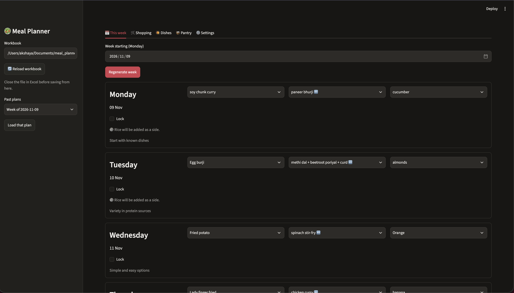
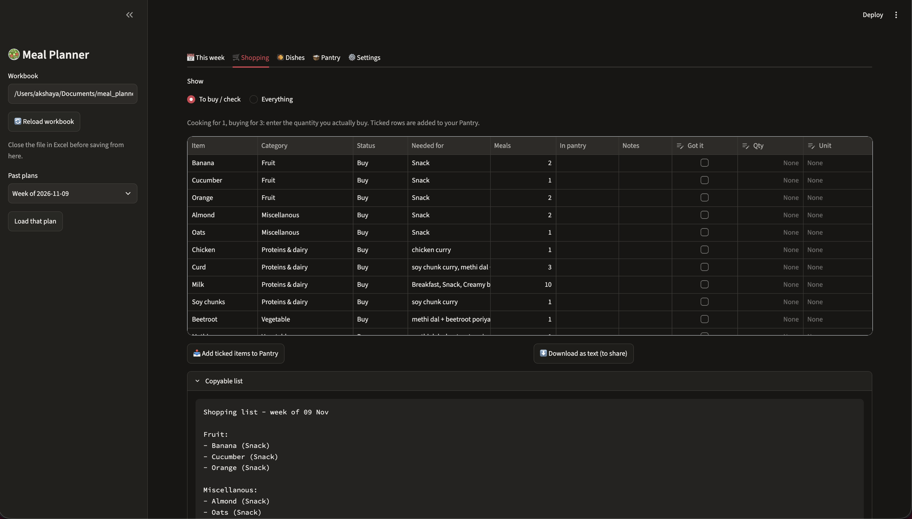
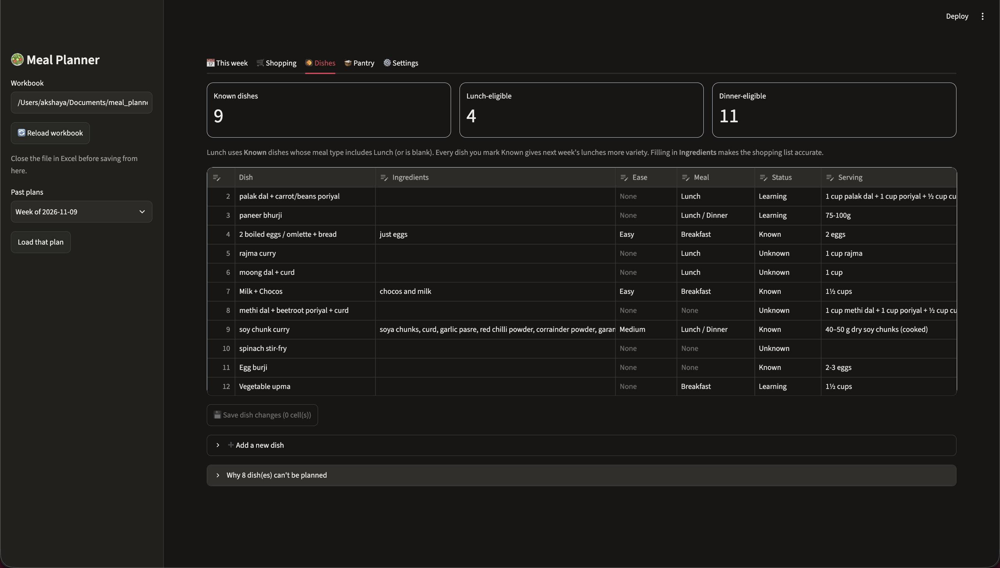
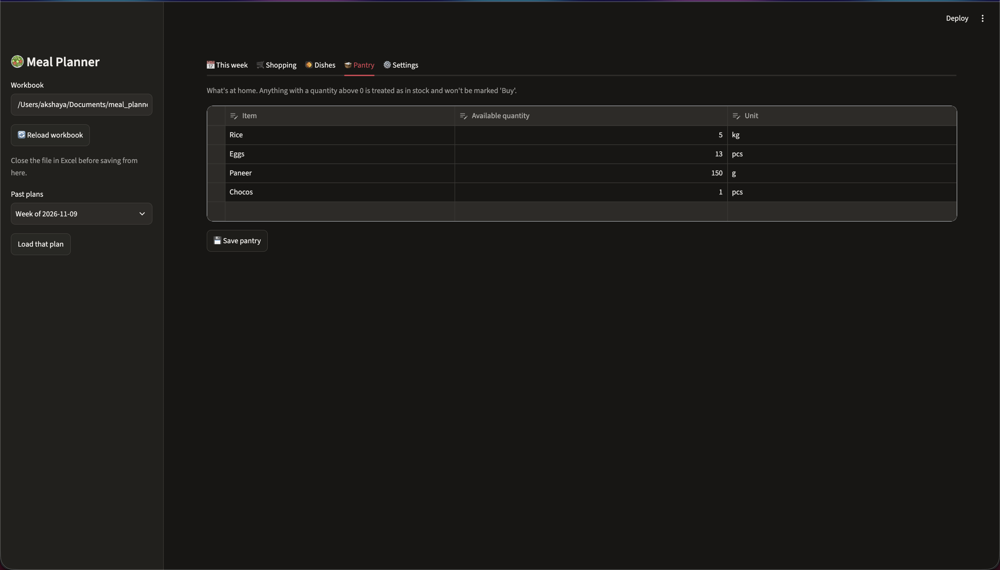

# Weekly Meal Planner

A local Streamlit app for planning meals from an Excel workbook. Ollama suggests a weekly plan; Python checks the meal rules and builds the shopping list from your dishes, ingredients, Grocery sheet, and Pantry.

## Start Here

1. Install [Ollama](https://ollama.com/) and pull the default model:

   ```bash
   ollama pull qwen2.5:7b
   ```

2. From this project folder, create the Python environment and install dependencies:

   ```bash
   python3 -m venv .venv
   source .venv/bin/activate
   pip install -r requirements.txt
   ```

3. Keep Ollama running, then launch the app:

   ```bash
   streamlit run app.py
   ```

   Open the local URL printed in the terminal. The default workbook is `Grocery.xlsx`; change its path in the sidebar to use another workbook. Close the workbook in Excel before saving changes from the app.

## Prepare the Workbook

The app looks for these sheets (names are not case-sensitive; spaces and underscores are interchangeable):

| Sheet | What to put there |
| --- | --- |
| `Grocery` | Put category names in row 1 and grocery items below each category. Add new foods here so ingredients can be categorized in the shopping list. |
| `What can i make` | One dish per row. Required: `Dish` (or `Recipe` / `Name`). Recommended: `Ingredients`, `Ease (E/M/D)`, `Serving size (1 person)`, `B / L / D`, and `Cooking status`. `Link` is optional. |
| `snacks` | Snack names in the first column, starting below the header. Add or remove snack choices directly in Excel. |
| `Pantry` | `Item`, `Available quantity`, and `Unit`. The app creates this sheet if it is missing. A quantity above zero counts as in stock. |
| `required` / `notes` | Optional nutrition preferences or reference notes for the model. |

Use meal values such as `Lunch`, `Dinner`, or `Lunch / Dinner`; leave the meal type blank to make a dish flexible for lunch or dinner. Set cooking status to `Known`, `Learning`, or `Not tried`. Known, non-difficult dishes are eligible for lunch; dinner can include dishes you are still learning. Add ingredients as a comma-separated list to improve shopping-list matching.

## Use the App

### This week

Choose a week starting date, then select **Generate week**. Change lunch, dinner, or snack using the dropdowns. Select **Lock** on days to keep them when regenerating. The plan is saved to `plans/plan_<Monday>.json` as you edit; use **Past plans** in the sidebar to reopen a saved week.



### Shopping

The list updates when you change meals. **To buy / check** hides pantry items; **Everything** shows them too. Enter the amount and unit you bought, tick **Got it**, then choose **Add ticked items to Pantry**. You can also download or copy a text list. Items missing from the Grocery sheet may appear as optional or need checking.



### Dishes

Edit a dish's ingredients, ease, meal type, status, or serving size in the table, then select **Save dish changes**. To add one, expand **Add a new dish**, enter its name and details, and submit. Model suggestions can also be added with **Add to Dishes**. These changes are written to the workbook selected in the sidebar.



### Pantry and Settings

Edit pantry items and quantities in the table, then select **Save pantry**. The Shopping tab's **Add ticked items to Pantry** does the same after a purchase. Settings such as the model, breakfast, repeat limits, and diet are saved to `config.json`, not to Excel.



## Saving to Excel

Dish and Pantry changes are saved directly to the selected workbook when you use their save buttons. A dated backup (for example, `Grocery_backup_2026-11-08.xlsx`) is created beside it before the first workbook save of that day.

Weekly plans are stored in `plans/` separately. To write the current plan into Excel, select **Save plan to Excel** on the This week tab. This creates or replaces the planner output sheets: `Meal Plan`, `Shopping List`, and `Prep Notes`; `Suggestions` is included when there are suggestions. Keep personal notes elsewhere, because these output sheets are regenerated when saved.

## Optional: Command Line

The non-UI planner saves a dated copy by default. To update the input workbook itself, it makes a dated backup first:

```bash
python meal_planner.py                  # writes a separate planned workbook
python meal_planner.py --inplace        # updates Grocery.xlsx after backing it up
python meal_planner.py --workbook path/to/food.xlsx
```

## Planning Rules and Health Note

Lunches favor Known dishes, dinners favor dishes to learn, and configured restrictions (such as dishes you cannot cook yet) are applied in code. The shopping list is calculated from workbook ingredients and Pantry contents, not generated by the model. Review meal and shopping suggestions before using them. This is a planning aid, not medical or nutrition advice; follow your clinician's guidance for vitamin D, folate, and B12.